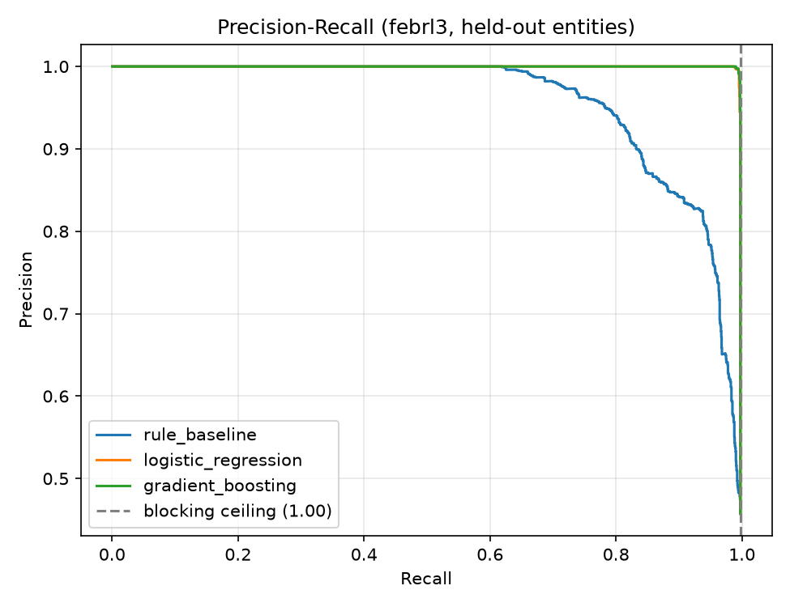
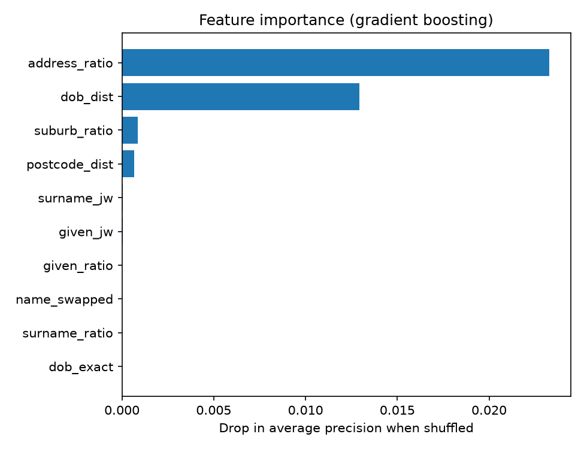
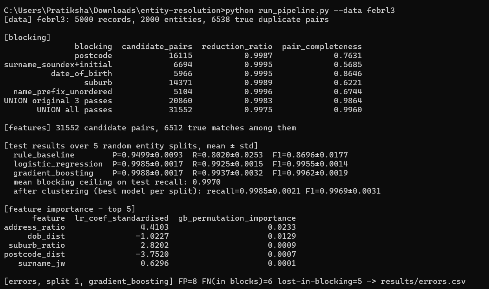

# Entity Resolution: Duplicate Customer Record Matching

Finds duplicate customer records using multi-pass blocking, fuzzy-string pair features and a
learned matcher, benchmarked against a rule-based baseline on held-out entities (Febrl3).

<p align="center">
  
  
</p>

<p align="center">
  
</p>
## Pipeline

1. **Data**: Febrl3 benchmark (5,000 records, 2,000 entities, 6,538 true duplicate pairs, realistic typos and
   missing values) or a Faker-based synthetic generator with planted duplicates and hard negatives.
   
2. **Multi-pass blocking**: candidate pairs are the union of five cheap keys: postcode, Soundex(surname)+initial,
   date of birth, suburb, and a swap-invariant name-prefix key. A typo that breaks one key is rescued by another.
   
4. **Pair features** (rapidfuzz): Jaro-Winkler/ratio on names, token-sort on address, exact/edit-distance on
   postcode and DOB, name-swap flag, Soundex match, missing-value count.
   
6. **Models**: hand-weighted rule baseline vs logistic regression vs gradient boosting; thresholds tuned on
   cross-validated train predictions, never on test.
   
8. **Evaluation**: split by *entity* (no leakage), repeated over several random splits (mean ± std). Recall is
   measured against ALL true pairs, so pairs lost in blocking count as misses. Predicted pairs are then clustered
   (connected components).
   
10. **Analysis**: PR curve, feature importance, and error analysis (`results/errors.csv`).

## Run
```bash
pip install -r requirements.txt
python run_pipeline.py --data febrl3 --seeds 5
python run_pipeline.py --data synthetic
```
Outputs go to `results/`: `blocking.csv`, `metrics_summary.csv`, `metrics_by_seed.csv`, `pr_curve.png`,
`feature_importance.csv/.png`, `errors.csv`.

## Results
**Iteration 1: 3 blocking passes, single split (seed 42)**

| Method | Precision | Recall | F1 |
|---|---|---|---|
| Rule baseline | 0.941 | 0.793 | 0.861 |
| Logistic regression | 0.997 | 0.985 | 0.991 |
| Gradient boosting | 0.998 | 0.986 | 0.992 |

Blocking: postcode alone 0.763 pair completeness; 3-pass union 0.986 (99.8% fewer comparisons: ~12.5M -> 20,860).
After clustering: precision 0.997, recall 0.999, F1 0.998.

**Iteration 2: 5 blocking passes, 5 random entity splits (mean ± std)**

| Method | Precision | Recall | F1 |
|---|---|---|---|
| Rule baseline | 0.950 ± 0.009 | 0.802 ± 0.025 | 0.870 ± 0.018 |
| Logistic regression | 0.9985 ± 0.0017 | 0.9925 ± 0.0015 | 0.9955 ± 0.0014 |
| Gradient boosting | 0.9988 ± 0.0017 | 0.9937 ± 0.0032 | 0.9962 ± 0.0019 |

Blocking (5 passes): pair completeness 0.996 (up from 0.986 with 3 passes and 0.763 with postcode alone);
31,552 candidate pairs vs ~12.5M possible (99.75% reduction). Mean blocking ceiling on test recall: 0.997.
After clustering the best model per split: recall 0.9985, F1 0.9969 (clustering recovers pairs blocking never compared,
but merges a few extra false positives, so F1 is roughly unchanged).

**Effect of the new passes (same split, seed 42):** pairs lost in blocking fell from 25 to 5. Total errors fell from
31 to 19; false positives and false negatives rose slightly (4 -> 8, 2 -> 6) because previously unseen pairs now
reach the classifier.

**Feature importance:** address similarity and date-of-birth edit distance dominate (permutation importance),
followed by suburb and postcode distance. Name features score low partly because the two name measures are
correlated, so shuffling one is compensated by the other.

## Error analysis (iteration 1)
- **81% of errors were pairs lost in blocking** (25 of 31): all had mismatched postcodes, and the rest of the
  keys failed due to swapped given/surname fields, typos that change the Soundex code, or a missing date of birth.
  Most still agreed on suburb and address, which motivated the suburb and swap-invariant name passes in iteration 2.
- **4 false positives** were one cluster of near-identical different people (same surname, postcode and suburb,
  DOBs differing by one digit), arguably label ambiguity.
- **2 false negatives** had a different address, postcode and DOB on each record: essentially unrecoverable.
- The classifier is near-perfect on candidates it sees; the remaining gap is blocking recall.
